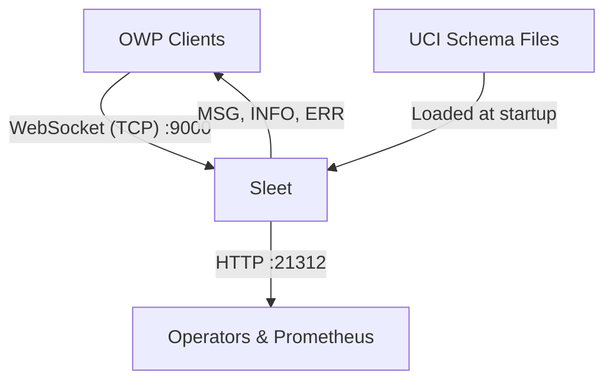

# Sleet

[](https://gitlab.com/open-arsenal/ams-gra/hello-world-sk/infra/sleet/-/releases)
[](https://gitlab.com/open-arsenal/ams-gra/hello-world-sk/infra/sleet/-/pipelines)
[](https://opensource.org/licenses/Apache-2.0)

> An OMS Language-Agnostic CAL (LA-CAL) server implemented in Rust that accepts OWP WebSocket connections, validates OMS JSON messages against the UCI schema, and routes messages by topic and message name.

## Table of Contents
- [Features](#features)
- [Prerequisites](#prerequisites)
- [Installation](#installation)
- [Configuration](#configuration)
- [Basic Usage](#basic-usage)
- [Testing](#testing)
- [Architecture](#architecture)
- [Documentation](#documentation)
- [Contributing](#contributing)
- [License](#license)

## Features

- OWP `INIT`, `PUB`, `SUB`, and `UNSUB` operation handling
- Schema-driven OMS JSON validation against UCI XSD
- Topic/message routing with optional subscription groups
- Prometheus metrics endpoint (`/metrics`)
- Liveness/readiness/status endpoints (`/health`, `/ready`, `/status`)
- Structured tracing with optional OTLP export (`otlp` feature)

## Prerequisites

- Local Rust Toolchain matching `rust-toolchain.toml` (for host builds)
- Podman (for containerized builds and execution)
- GNU Make (for driving the build and test targets)

## Installation

### Get the source

```bash
git clone https://gitlab.com/open-arsenal/ams-gra/hello-world-sk/infra/sleet.git
cd sleet
```

## Configuration

Sleet is configured with a server TOML file and per-service TOML files:

- Server config: `config/server.toml`
- Service configs: `config/services.d/*.toml`

### Server Configuration

Example:

```toml
bind_addr = "0.0.0.0:9000"
server_id = "sleet-server-1"
system_label = "Example OMS Platform"
schema_path = "./spec/002.5.0/UCI_MessageDefinitions_v2_5_0.xsd"
schema_version = "002.5.0"
system_uuid = "123e4567-e89b-12d3-a456-426614174000"
services_dir = "./config/services.d"
metrics_bind_addr = "0.0.0.0:21312"
```

### Service Authorization

Sleet implements strict service authorization and will reject WebSocket connections from any service that isn't explicitly defined in its configuration.

New components must be authorized by creating a `[service].toml` file in the configured `services_dir` (default: `./config/services.d/`). Sleet loads these files on startup.

Each service definition requires a `service_id`, `service_uuid`, and the topics and messages it is allowed to publish/subscribe to.

Example `config/services.d/sensor.toml`:

```toml
service_id = "sensor-service-1"
service_uuid = "550e8400-e29b-41d4-a716-446655440000"
allowed_topics = ["TRACKS"]

[[topic_bindings]]
topic = "TRACKS"
allowed_messages = ["EntityState", "SensorMeasurement"]
```

See [docs/configuration.md](docs/configuration.md) for the full configuration reference.

## Basic Usage

### Container

```bash
# Run the published image (replace registry.gitlab.com with your actual registry)
podman-compose pull
podman-compose up
```

*Note: If you are not pulling from the remote registry and need to build the images locally instead, please see the [Building Container Images](docs/building-images.md) guide.*

### Local source build

```bash
# Build the runtime image from local source
make compose-build-up

# Build using the builder image (for local iteration with source mounted)
make compose-dev-up
```

### Host build

```bash
make fetch-spec
make host-build
./target/debug/sleet config/server.toml
```

## Testing

### LA-CAL Harness

You can locally run the OMS LA-CAL compliance harness against Sleet via the `compose.harness.yaml` overlay:

```bash
# Validates the harness connection
make harness-preflight

# Fast standard validation (runs automatically in `make gate`)
make harness-smoke

# Standard validation
make harness-standard

# Full matrix validation
make harness-exhaustive
```

See [docs/la-cal-harness-integration.md](docs/la-cal-harness-integration.md) for details on modifying the test configuration if you add new Sleet topics or services.

## Architecture



Compose publishes the WebSocket and admin ports on host ports `21402` and `21312` by default.

See [docs/architecture.md](docs/architecture.md) for internals and [docs/contracts.md](docs/contracts.md) for interface details.


## Documentation

- [docs/architecture.md](docs/architecture.md)
- [docs/configuration.md](docs/configuration.md)
- [docs/contracts.md](docs/contracts.md)
- [docs/decisions.md](docs/decisions.md)
- [docs/la-cal-harness-integration.md](docs/la-cal-harness-integration.md)
- [docs/schema-sourcing.md](docs/schema-sourcing.md)
- [docs/compliance](Open Standards compliance documentation)

## Contributing

Contributions are welcome! Please see our [CONTRIBUTING.md](CONTRIBUTING.md) for the full development workflow, MR requirements, and release process.

There are instructions for [troubleshooting and getting help](docs/troubleshooting.md).

## License

Apache License 2.0. See [LICENSE](LICENSE) and [INTENT.md](INTENT.md).

Copyright (c) 2026-present U.S. Federal Government (in countries where recognized).
